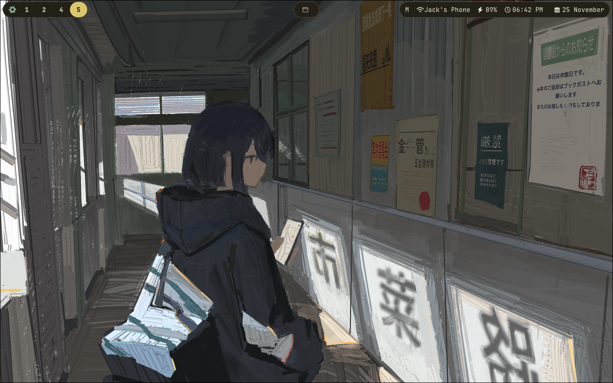
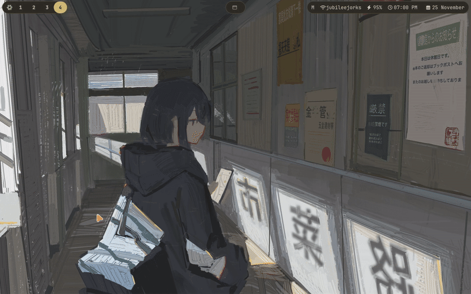
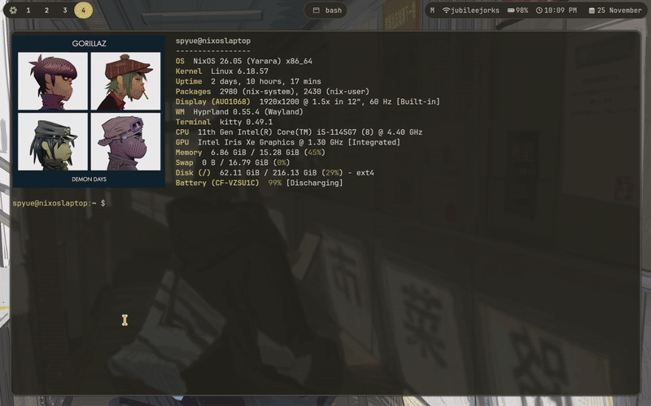

# Spyue's NixOS Config



This is my NixOS setup, keep in mind it is my first time using Linux other than a brief stint with Debian. Some things to note are there are wallpapers in here that are not mine, almost all of them are from wallhaven.cc. Take a look around and let me know if you have any suggestions or questions @spyue@proton.me or on discord @spyue. (I will eventually update this README to include more info)

## Basic Outline

- **Flake-based, multiple-hosts:** this repo builds all my machines with nearly everything shared between them (other than what I don't want shared)
- **Home Manager:** for packages and settings, as a nix module
- **live-linked dots:** dotfiles are linked to ~/.config so the edits apply without needing to rebuild
- **Dynamic theming by wallpaper:** a custom quickshell wallpaper picker runs matugen, upon selection apps such as hyprland, waybar, kitty, nvim, Firefox, Vesktop(discord), and more update their themes to match
- **Graphical boot and lock:** plymouth splash for luks password followed by auto login and auto put into hyprlock screen (temp solution until custom quickshell login sequence)

**Here is the lock screen it boots to:**


## Current Machines

| Host          | Model                                        |
| ------------- | -------------------------------------------- |
| 'nixoslaptop' | Panasonic Lets Note cf-sv1                   |
| 'nixostower'  | Custom Gaming pc (Ryzen 5 5600x, RX 6650 XT) |

## File Structure

```
.
├── dotfiles
│   ├── fastfetch
│   ├── hypr
│   ├── kitty
│   ├── matugen
│   ├── musikcube
│   ├── nvim
│   ├── quickshell
│   ├── waybar
│   └── wofi
├── hosts
│   ├── nixoslaptop
│   └── nixostower
└── modules
    ├── home
    └── nixos
```

## How It Works

The flake lists every input in the flake.lock, making builds reproducible, and defining each machine in a small mkHost helper.
Each host only contains what is specific to it (hardware file, encryption, packages, settings, etc), while everything shared stays in modules/nixos/ if it's system level config and modules/home/ for user env. Home Manager runs as a NixOS module so that nixos-rebuild builds the system and home together while storing each generation (system and home) allowing boot menu rollbacks.

Configurations stay in dotfiles/ which are linked to ~/.config with mkOutOfStoreSymlink allowing edits to apply immediately without rebuild while still being in the repo. (This is important for the theme syncing)

## Theme System



Super+W brings up the wallpaper picker which previews the main color as you hover over each wallpaper. On selection awww sets the wallpaper and runs matugen. Matugen then generates a Material You palette from the image. Templates turn that palette into color files for each of the configured apps with post-hooks signaling running apps to reload to apply the theme. This allows the system to stay mostly color coordinated.

**This is a diagram generated by claude that demonstrates the theme system pretty well:**

```
Super+W ──► Quickshell picker ──► Enter
                                    │
               ┌────────────────────┼─────────────────────┐
               ▼                    ▼                     ▼
         awww sets the      matugen generates      ~/.cache/current-wallpaper
        wallpaper with a     a palette from          link updated
        grow transition       the image             (for hyprlock)
                                    │
                    templates fill in the colors
                                    │
                ┌──────────┬────────┴───┬────────────┬──────────┐
                ▼          ▼            ▼            ▼          ▼
             Waybar      Kitty      Hyprland      Neovim     GTK, LibreWolf,
                                                             Vesktop, wofi,
                                                             hyprlock, ...
                                    │
                    post-hooks tell running apps to reload
```

## Problems Throughout The Switch To Linux (NixOS)

Throughout the process of switching from Windows 11 for work, school, gaming, devwork, etc... I encountered a few issues (allbeit mainly on the desktop with gaming). That being said the process is actually pretty quick and I would totally recommend.

**Slow wifi on pc:** my link to my wifi in my apartment seemed pretty stable sitting at around 63 dBm on multiple devices but I was getting download speeds under 10 Mbps. After testing each band it became apparent that it was a channel specific issue. I just switched to 2.4G on my desktop and now have almost perfectly stable connections (cross my fingers) with the only problem being still semi slow download rates. Overall I got to fix my issue of unstable connection during calls/games but unfortunately I will have to live with slow internet as unless I spend money or drill holes in the floor it's out of my control.

**Games Ignoring mouse:** Proton games were treating the wrong monitor as primary causing my mouse to hover on my screen while tabbed into a game. This was a relatively simple fix, all i had to do was set the primary monitor explicitly upon login.

## Usage

The setup I have is tailored to my needs and things I like. If you want to use them I suggest cleaning it up to tailor your needs better but if you want to just clone my setup go for it.

First clone the repo (keep name as nixos-config) then use either of the following commands:

- gaming uses my tower settings that I use on my gaming pc but still comes with most of the dev specific stuff I have on laptop
- school/work uses my laptop settings which exclude things like vesktop(discord) and some other things

**Gaming**

```
sudo nixos-rebuild switch --flake .#nixostower
```

**School/Work**

```
sudo nixos-rebuild switch --flake .#nixoslaptop
```

## Credits

- [matugen](https://github.com/InioX/matugen) and [matugen-themes](https://github.com/InioX/matugen-themes) for palette generation and templates

## License

MIT
